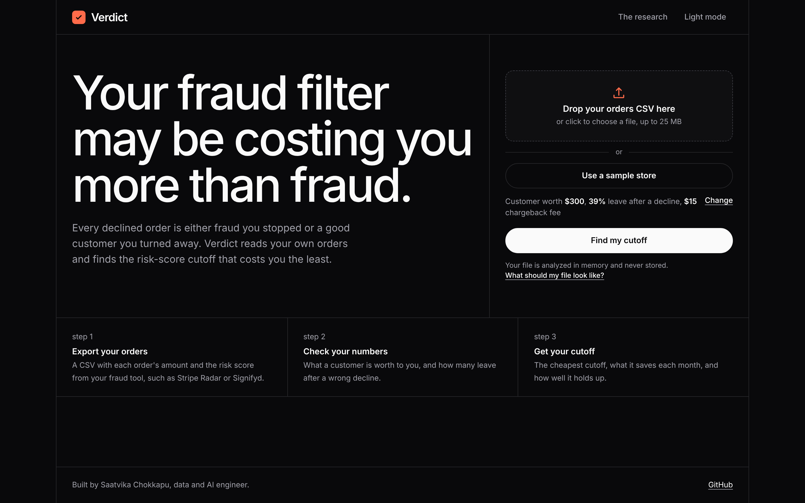
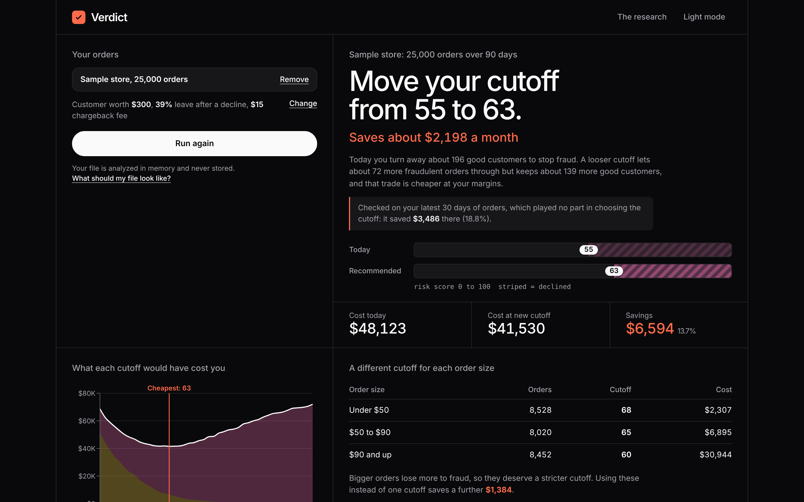
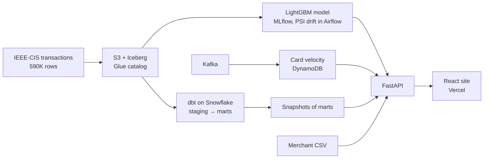

# Verdict

**Find the fraud cutoff that costs your store the least.**

Live: https://verdict-saatvika.vercel.app

Every order a fraud filter declines is either fraud that was stopped or a good customer who was turned away. Most stores set their risk-score cutoff once and never price that trade-off. Verdict takes a store's own orders, prices every possible cutoff in dollars, and recommends the cheapest one, then checks that recommendation on recent orders it never saw.



## What it does

Upload a CSV of orders with an amount and the risk score from any fraud tool (Stripe Radar, Signifyd and others), or use the built-in sample store. Enter what a customer is worth to you and how many leave after a wrong decline. Verdict returns:

- **The recommended cutoff**, and what it saves per month compared with your current setup
- **A check on unseen orders.** The cutoff is chosen from the earliest two thirds of your orders and measured on the most recent third
- **A separate cutoff for small, medium and large orders**, because fraud on a $400 order costs more than fraud on a $25 one
- **A sensitivity check** showing whether the recommendation still wins if your customer-value estimate is off by half or double



On the sample store (25,000 synthetic orders over 90 days), moving the cutoff from 55 to 63 saves about $2,200 a month. Chosen blind from the first 60 days, the cutoff saved $3,486 on the last 30 days, against $3,554 for the best cutoff in hindsight.

## How the analysis stays honest

- **Declined orders have no fraud outcome.** They were never charged, so they can't charge back. Treating the raw risk score as a probability overstated fraud on them (57% estimated against 35% actual on the sample). Verdict instead fits how scores relate to real chargebacks on approved orders and extends that curve to the declined range.
- **Third-party scores are rankings, not probabilities.** A cutoff only needs the ranking, so the recommendation holds whichever fraud tool produced the score.
- **In-sample results flatter.** A cutoff always looks good on the orders it was chosen from, so every result with dates is re-checked out of time, and the page says when that check fails.
- **Thin data falls back.** An order-size band with too little fraud to learn from keeps the overall cutoff, and the page says so.

## Architecture



Infrastructure is provisioned with Terraform. The API runs on Render and the frontend on Vercel.

**Two parts share one codebase:**

1. **The research pipeline.** A LightGBM fraud model trained on 590,540 real card transactions, a FastAPI decision endpoint that approves or declines each transaction by expected dollar cost, and dbt models on Snowflake that measure the result. The site serves a snapshot of those marts, so it stays up without a running warehouse.
2. **The merchant analyzer** (`backend/analyzer.py`). Accepts messy CSVs, recognizes common column names (or asks the user to match them), calibrates the store's scores, prices every cutoff and backtests the choice.

## Research results

- **Dataset:** IEEE-CIS Fraud Detection (Kaggle), 590,540 transactions, 3.5% fraud
- **Model:** LightGBM, 0.872 ROC-AUC and 0.394 PR-AUC on a stratified 20% hold-out
- **Decision policy:** $126,129 (4.8%) lower total cost than a fixed 0.5 probability cutoff over six months, catching less fraud by count but fraud worth 1.75× more per case ($405 against $231)
- **Limit:** the advantage disappears if a lost customer really costs more than about 1.55× the documented estimate. See [`docs/cost_model_assumptions.md`](docs/cost_model_assumptions.md)
- **Latency:** p50 1.45 ms, p95 1.61 ms for in-process inference and policy over 2,000 requests

## API

| Endpoint | What it does |
|---|---|
| `POST /api/analyze` | Analyze an uploaded CSV, or the sample store. Rate limited per IP |
| `GET /api/template.csv` | Download the expected file format |
| `POST /api/decision` | Score one transaction and approve, decline or send to review by expected cost |
| `GET /api/cost-analysis`, `/api/sensitivity-analysis`, `/api/threshold-simulator` | Research results |
| `GET /api/pipeline/health` | Data source, drift status, model version and measured latency |

## Testing

73 pytest tests and 10 dbt tests. GitHub Actions runs pytest and the latency benchmark on every push.

```
python -m pytest tests -q            # analyzer, cost policy, PSI drift bands, API contract, rate limit
python backend/benchmark_latency.py  # writes backend/latency_report.json
cd riskflow_dbt && dbt test          # needs a Snowflake connection
```

The analyzer tests check that a recommended cutoff never costs more than any cutoff on the curve, that the backtest choice is unaffected by tampering with the later orders, that it never beats the hindsight optimum, and that a column-matching suggestion can only point at columns that exist.

## What I learned

- **A good-looking number can be in-sample.** My first version measured savings on the same orders it chose the cutoff from. Adding an out-of-time check made the result smaller in some cases but believable in all of them.
- **Missing labels are not random.** Declined orders never get a fraud outcome, and filling that gap with the raw score overstated fraud badly. Calibrating on the labeled orders fixed it.
- **Free tiers expire.** The Snowflake trial ended and every data endpoint started failing. I moved the site to snapshots of the marts with an environment flag for live mode, and pinned the Python version after a deploy broke on a newer runtime.
- **The use case has to be obvious.** The first version was a report about one dataset. Turning it into a tool that runs on a visitor's own orders made it something a business could actually use.

## Running locally

```
pip install -r requirements.txt
uvicorn backend.main:app --reload          # API on :8000, serves snapshots by default
cd frontend && npm install && VITE_API_URL=http://localhost:8000 npm run dev
```

Optional environment variables:

| Variable | Effect |
|---|---|
| `DATA_SOURCE=snowflake` | Query the live warehouse instead of the snapshots (needs Snowflake credentials, see `.env.example`) |
| `ANTHROPIC_API_KEY` | Suggest column matches for unrecognized CSVs. Only column names are sent |
| `SENTRY_DSN` | Report API errors to Sentry |
| `ANALYZE_RATE_LIMIT` | Uploads allowed per IP per minute (default 12) |

The full pipeline (Kafka, Airflow, Terraform) runs with `docker-compose up` and the AWS, Snowflake and Databricks credentials in `.env.example`.

## Stack

Python · SQL · LightGBM · scikit-learn · FastAPI · Kafka · AWS S3, Glue, DynamoDB · Apache Iceberg · Airflow · Snowflake · dbt · Databricks MLflow · Terraform · GitHub Actions · React · TypeScript · Recharts · Vercel · Render

---

Built by Saatvika Chokkapu · [Portfolio](https://saatvikachokkapu.com/) · [LinkedIn](https://www.linkedin.com/in/saatvikachokkapu/)
